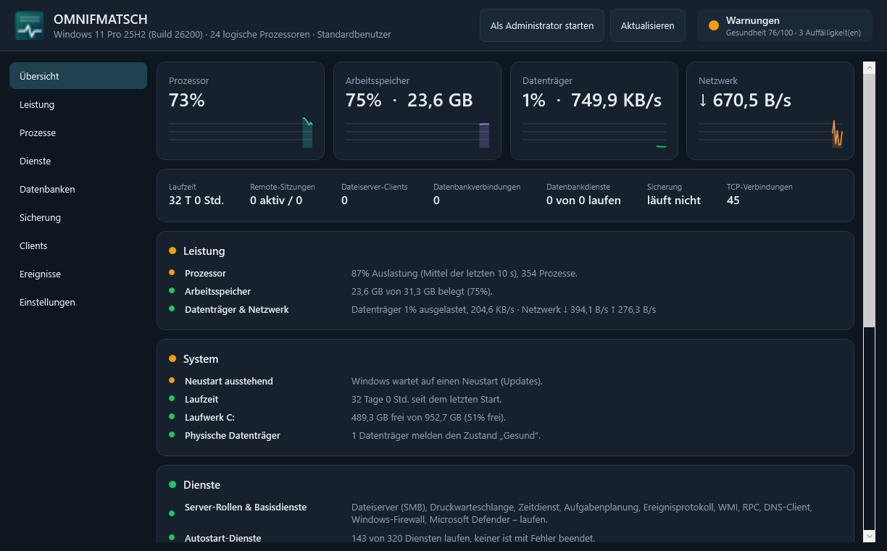
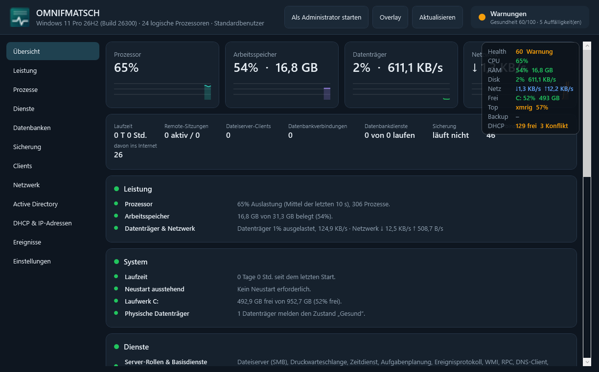

# ServerManagerPro

Der **Task-Manager für Server**: CPU, Speicher, Prozesse und Dienste – plus der Gesundheitscheck, den man sonst an zehn Stellen zusammensucht.

- Welche **Dienste** laufen – Server-Rollen (AD, DNS, DHCP, IIS, Hyper-V …) und eigene „muss laufen“-Dienste?
- Welche **Datenbanken** laufen, und wie ausgelastet ist der Datenbankserver (CPU, RAM, Verbindungen, bei SQL Server Batch-Requests/s, Seitenlebensdauer, Blockierungen)?
- Läuft gerade ein **Backup**? Wann war das letzte erfolgreiche?
- Wie viele **Clients** sind am Server (Remotedesktop, SMB, TCP-Verbindungen)?
- Welche **Netzwerkverbindungen** bestehen – getrennt nach lokalem Netz (LAN) und Internet?
- Auf **Domänencontrollern**: Zustand von Active Directory (Dienste, Replikation, Betriebsmaster, Benutzer, gesperrte Konten).
- Auf **DHCP-Servern**: Bereiche, Leases und ein IP-Scan, der zeigt, welche Adressen *wirklich* vergeben werden können.
- **Overlay:** frei gewählte Kennzahlen als kleines, klickdurchlässiges Fenster dauerhaft im Vordergrund – wie ein FPS-Overlay.
- **Sicherheit & Hardware:** ausstehende Updates, Virenschutz, Firewall, Zertifikats-Ablauf, offene Ports, Datenträger-Verschleiß und -Temperatur, USV.
- **Rollen:** Hyper-V, IIS, Druckserver, Dateiserver-Kontingente, Exchange, DFS.
- Dazu: Laufwerke, Datenträger-Zustand, ausstehender Neustart, Fehler im Ereignisprotokoll.

Alles fließt in eine Ampel und einen Gesundheitswert von 0–100 – jede Auffälligkeit mit Klartext-Begründung.

Läuft auf **Windows Server 2016/2019/2022/2025** sowie **Windows 10 und 11** (64 Bit), auch auf kleinen Bildschirmen: die Oberfläche passt sich an und funktioniert bis **1024×768** (Mindestgröße des Fensters 800×540). Seite mit Screenshots: <https://fmatsch.ist/ServerManagerPro/>



## Installation

**Setup (empfohlen):** `ServerManagerPro-Setup-<Version>.exe` von der [Release-Seite](https://github.com/fmatsch/ServerManagerPro/releases/latest) ausführen. Es installiert nach `C:\Program Files\ServerManagerPro`, legt Startmenü-Einträge an (Hauptprogramm und „Overlay“) und bietet optional an, das Overlay bei der Anmeldung im Hintergrund zu starten. Ein erneutes Ausführen aktualisiert die vorhandene Installation (laufende Instanzen werden geschlossen und danach wieder gestartet). Einstellungen unter `C:\ProgramData\ServerManagerPro` bleiben beim Deinstallieren erhalten. Stille Installation: `ServerManagerPro-Setup-<Version>.exe /SILENT`.

**Ohne Installation:** ZIP von der [Release-Seite](https://github.com/fmatsch/ServerManagerPro/releases/latest) laden, entpacken, `ServerManagerPro.exe` starten. Die EXE bringt .NET mit; es muss nichts installiert werden. Für das volle Bild als **Administrator** starten (Button in der Kopfzeile).

## Alarme und Fernzugriff ohne eigenen Server

**Alarme** (*Alarme & Zugriff*): Die App meldet Warnungen und kritische Probleme nach außen – an **ntfy** (Handy), **Microsoft Teams** (Workflow-Webhook), **Slack**, **Telegram**, einen **eigenen Webhook** (JSON) oder als **Sprechblase am Tray-Symbol**. Es werden nur ausgehende Verbindungen aufgebaut, es gibt keinen offenen Port. Damit sie nützlich und nicht lästig sind:

- ein Problem wird erst gemeldet, wenn es länger als die **Verzögerung** (Standard 3 Minuten) besteht – kurze Spitzen lösen nichts aus
- **keine Doppelmeldungen**; eine **Erinnerung** nach einstellbarer Zeit (Standard 12 Stunden), solange das Problem besteht
- wird es schlimmer (Warnung → kritisch), kommt sofort eine Meldung; wird es **behoben**, kommt eine Entwarnung mit der Dauer
- viele Probleme gleichzeitig werden zu **einer** Nachricht zusammengefasst; pro Stunde gilt ein **Höchstwert** (danach eine Hinweis-Nachricht)
- die Ziele enthalten Geheimnisse (Webhook-Adressen, Tokens) und werden mit Windows-DPAPI verschlüsselt gespeichert; „Testnachricht senden“ prüft jedes Ziel

Die App muss laufen, damit gemeldet wird – am einfachsten im Hintergrund als Overlay mit Autostart (`--overlay`).

**Status-Zugriff (nur lesen):** Optional macht die App die Zusammenfassung des Rechners über HTTPS abrufbar (`/api/status` als JSON, `/` als kleine Webseite). Nur `GET`, nur mit Token, ohne Einstellungen und Zugangsdaten, mit selbstsigniertem Zertifikat (Fingerabdruck wird angezeigt). Standardmäßig aus und nur auf `127.0.0.1`; für den Zugriff von außen die Adresse eines **VPN-Adapters** eintragen (Tailscale, WireGuard) und in der Windows-Firewall freigeben – die App ändert die Firewall nicht. **Nicht ins offene Internet stellen.**

**Server-Liste:** Andere Installationen tragen diesen Server unter *Entfernte Server* ein (`Name|https://adresse:8765|Token|Fingerabdruck`). Auf der Seite *Server* sehen Sie dann alle Server auf einen Blick; die Alarme gelten auch für sie – inklusive Meldung, wenn ein Server nicht mehr antwortet. Das braucht weder einen eigenen Server noch Cloud-Speicher, nur Erreichbarkeit zwischen den Rechnern (VPN).

## Sprache, Updates, Bedienung

- **Sprache:** Deutsch und Englisch (*Einstellungen → Sprache*, „Automatisch“ folgt der Windows-Sprache; Änderung nach Neustart). Die Oberfläche, Beschriftungen, Tabellenköpfe, die Prüfungsnamen und die häufigsten Meldungen sind übersetzt. **Seltenere Meldungen und Werte, die Windows selbst liefert, bleiben deutsch bzw. in der Sprache von Windows.**
- **Update-Prüfung (aus, bis Sie sie einschalten):** *Einstellungen → Automatisch nach Updates suchen* fragt beim Start und danach täglich bei GitHub die Release-Liste ab (anonym, keine Daten über Sie oder den Rechner). Bei einer neuen Version erscheint ein Knopf in der Kopfzeile. Ist die App über das Setup installiert, lädt der Knopf das Setup herunter, **prüft die SHA-256-Summe** gegen `SHA256SUMS.txt` des Releases und startet es erst bei Übereinstimmung; bei einer portablen Kopie öffnet er die Release-Seite. „Nach Updates suchen“ prüft sofort.
- **Tastatur:** `F5` aktualisiert, `Strg+1 … 9` wechselt die Seite, `Strg+F` springt in das Filterfeld der Seite, `Esc` leert es. Schaltflächen haben einen sichtbaren Fokusrahmen; Eingabefelder, Diagramme und Tabellen tragen Namen für Screenreader, Ampelpunkte haben zusätzlich einen Text (Tooltip).
- **Farben:** Text und Statusfarben erreichen auf den dunklen Flächen mindestens 4,5:1 Kontrast (gemessen); der Status wird nie nur über die Farbe vermittelt.
- **Overlay auf mehreren Bildschirmen:** Das Overlay kann auf einem frei wählbaren Bildschirm in einer Ecke stehen (*Einstellungen → Overlay → Bildschirm*) oder per Ziehen frei positioniert werden.
- **Kleine Bildschirme:** bis 1024×768 bei 100 % Skalierung, in einer sehr schmalen Ansicht auch bei höherer Skalierung (z. B. 1024×768 bei 150 % ≈ 683×512 Pixel): Die Navigation wird dann zur Auswahlliste.

## Overlay

Ein kleines Fenster über allem anderen mit den Kennzahlen, die Sie unter *Einstellungen → Overlay* auswählen (Gesundheitswert, CPU, RAM, Datenträger, Netzwerk, freier Platz, Top-Prozess, Datenbank, Remote-Sitzungen, SMB, Internet-Verbindungen, Backup, DHCP, Active Directory).

- klickdurchlässig und ohne Fokus – Maus und Tastatur gehen durch das Overlay hindurch
- **Strg+Alt+O** ein/aus, **Strg+Alt+M** Hauptfenster; Tray-Symbol: verschieben, Hauptfenster, beenden
- Position in jeder Ecke oder frei verschiebbar, untereinander oder als Leiste, Deckkraft und Schriftgröße einstellbar
- läuft nur das Overlay, arbeitet die App mit niedriger Priorität und misst nur das Nötige (gemessen: gut 4 % eines Kerns auf einem 24-Thread-Rechner mit Gesundheitswert)
- Start direkt im Hintergrund: `ServerManagerPro.exe --overlay`; optional mit Windows starten (Einstellungen)
- Hinweis: sichtbar über Fenstern und randlosen Vollbildern, nicht über Programmen im exklusiven Vollbildmodus



## Was erkannt wird

| Bereich | Quelle |
|---|---|
| Leistung | Leistungsindikatoren (CPU gesamt/je Kern, RAM, Datenträger, Netzwerk) |
| Dienste | WMI `Win32_Service`, Rollen-Liste, eigene Überwachungsliste |
| Datenbanken | SQL Server, PostgreSQL, MySQL/MariaDB, Oracle, MongoDB, Firebird, Redis (Dienste) + TCP-Tabelle; SQL-Server-Leistungsindikatoren |
| Sicherung | Windows Server Backup (Ereignisprotokoll), Veeam, Acronis, Backup Exec, Macrium u. a. (Dienste/Prozesse), geplante Aufgaben mit Backup-Stichwörtern, SQL-Backup-Durchsatz, VSS |
| Netzwerk | `GetExtendedTcpTable` mit Prozessnamen; Einteilung nach privaten Adressbereichen (RFC 1918, Link-Local, CGNAT), Loopback, Internet |
| Active Directory | Dienste (NTDS, KDC …), SYSVOL/NETLOGON, `System.DirectoryServices` (Konten, FSMO, Replikation); nur wenn der Dienst NTDS existiert |
| DHCP | PowerShell-Cmdlets `Get-DhcpServerv4*` (Bereiche, Leases, Reservierungen, Ausschlüsse) + IP-Scan per Ping und ARP; nur wenn der Dienst DHCPServer existiert |
| Sicherheit | Update-Verlauf und ausstehende Updates (Windows-Update-Agent, nur Daten des letzten Scans), Microsoft Defender, Windows-Firewall (Profile), BitLocker, Zertifikate (Ablauf), Ports auf allen Netzwerkkarten |
| Hardware | Datenträger-Zustand, Temperatur, Verschleiß, unkorrigierte Lesefehler (Storage-Zuverlässigkeitszähler), SMART-Vorhersage, Speicherplätze, ACPI-Temperaturen, USV/Batterie |
| Rollen | Hyper-V (VMs, Checkpoints, Replikation, Heartbeat), IIS (Websites, Pools, HTTPS-Zertifikate), Druckwarteschlangen, FSRM-Kontingente, Exchange-Dienste und Mailwarteschlange, DFS-Replikation |
| Clients | Terminaldienste (WTS), `MSFT_SmbSession`, `GetExtendedTcpTable` |
| System | Laufzeit, Neustart ausstehend, Laufwerke, `MSFT_PhysicalDisk` |
| Ereignisse | System- und Anwendungsprotokoll der letzten 24 h |

Schwellenwerte, zusätzliche Dienste und Backup-Stichwörter stehen unter *Einstellungen* und in `C:\ProgramData\ServerManagerPro\settings.json`.

## Signierung

Die veröffentlichten EXE-Dateien sind **nicht signiert** (dafür braucht es ein Code-Signing-Zertifikat, das nicht kostenlos ist), Windows SmartScreen warnt deshalb. Die CI signiert automatisch, sobald im Repository die Secrets `SIGN_PFX_BASE64` (PFX-Datei, Base64) und `SIGN_PFX_PASSWORD` hinterlegt sind: EXE und Setup werden dann mit `signtool` samt Zeitstempel signiert. Bis dahin: Prüfsummen stehen in `SHA256SUMS.txt` beim Release.

## Grenzen

- **Alarme:** Die Kanäle sind gegen einen lokalen Testserver geprüft (Format, Zeichensatz, Token, Ablauf mit Verzögerung/Erinnerung/Entwarnung/Limit). Gegen die echten Dienste (ntfy, Teams, Slack, Telegram) habe ich sie nicht ausprobiert; bei Teams gilt das Workflow-Webhook-Format. Die Sprechblase am Tray ist nicht automatisch getestet. Ohne laufende App gibt es keine Meldungen, und es gibt (noch) keinen Verlauf der Messwerte.
- **Status-Zugriff:** getestet mit TLS, Token-Prüfung und Fingerabdruck auf dem eigenen Rechner (Loopback), nicht über ein echtes VPN. Das Token steht in der Adresse der Webseite (`?token=`) – nur im VPN verwenden.

- **Nicht auf echten Systemen geprüft** (nur gegen die Windows-Schnittstellen entwickelt): Hyper-V, IIS, Druckserver, FSRM, Exchange, DFS, die PostgreSQL-/MySQL-Detailwerte, DHCP-Failover und -IPv6 sowie die Zertifikatsliste. Auf dem Testrechner waren diese Rollen bzw. Zertifikate nicht vorhanden. Über Fehlerberichte freue ich mich.
- **PostgreSQL/MySQL-Details** brauchen eine Verbindung (*Einstellungen → Datenbank-Verbindungen*), am besten mit einem Benutzer, der nur lesen darf. Die Verbindungszeichenfolge wird mit Windows-DPAPI verschlüsselt (Computer-Schlüssel: schützt vor dem Lesen der Datei, nicht vor anderen Benutzern auf demselben Computer).
- **Ports:** Es wird nur angezeigt, was auf allen Netzwerkkarten lauscht. Ob ein Port aus dem Internet erreichbar ist, wird nicht geprüft.
- **Hardware:** Temperatur, Verschleiß und SMART liefert Windows nur für manche Datenträger/Treiber und teils nur mit Administratorrechten. Lüfter, RAID-Controller und iDRAC/iLO (Redfish) werden nicht abgefragt.
- **Updates:** Die Zahl ausstehender Updates stammt aus dem letzten Scan von Windows; die App löst keine Suche im Netz aus.
- **MAC-Herkunft:** Es werden nur zufällige/lokale Adressen und bekannte virtuelle Adapter erkannt, keine vollständige Herstellerliste.

- Active-Directory- und DHCP-Seiten sind nur mit Beispieldaten (`--demo`) auf einem normalen PC getestet, nicht auf einem echten Domänencontroller/DHCP-Server. Fehlerberichte willkommen.
- Der IP-Scan prüft im eigenen Subnetz per ARP (findet auch Geräte mit blockiertem Ping), in anderen Subnetzen nur per Ping. Pro Bereich werden höchstens 4096 Adressen betrachtet; der Scan läuft alle 10 Minuten oder per Knopf.
- Ohne Administratorrechte fehlen SMB-Clients, SQL-Leistungsindikatoren, manche Aufgaben und das Steuern von Diensten.
- Backup-Erkennung ist heuristisch (Dienste, Prozesse, Aufgaben, Ereignisprotokoll). Fehlt Ihre Lösung, helfen Stichwörter in den Einstellungen.
- Detailwerte gibt es für SQL Server; andere Datenbanken zeigen Zustand, CPU, RAM und Verbindungen.
- Die EXE ist nicht signiert (SmartScreen-Hinweis).
- **Setup, Update-Installation, Signierung und Bildschirmwahl** sind nur teilweise geprüft: Das Setup wird von der CI gebaut, ich habe es aber nicht selbst installiert; die automatische Update-Installation (Download, Prüfsumme, Start des Setups) ist nicht Ende-zu-Ende ausprobiert; die Signierung ist ohne Zertifikat nicht getestet; die Bildschirmwahl wurde mit nur einem Bildschirm entwickelt.
- Screenreader (Narrator, NVDA) und der Windows-Kontrastmodus wurden nicht getestet.

## Selbst bauen

Benötigt das .NET 8 SDK.

```powershell
dotnet build src/ServerManagerPro -c Release
dotnet publish src/ServerManagerPro -c Release -r win-x64 --self-contained -p:PublishSingleFile=true
```

Kopfloser Selbsttest, schreibt alle Prüfungen in eine Textdatei: `ServerManagerPro.exe --selftest bericht.txt`

IP-Bereich scannen (Diagnose): `ServerManagerPro.exe --scantest 192.168.1.1-192.168.1.254 antworten.txt`

Oberfläche mit Beispieldaten für AD/DHCP: `ServerManagerPro.exe --demo`

## Lizenz

MIT – siehe [LICENSE](LICENSE).
